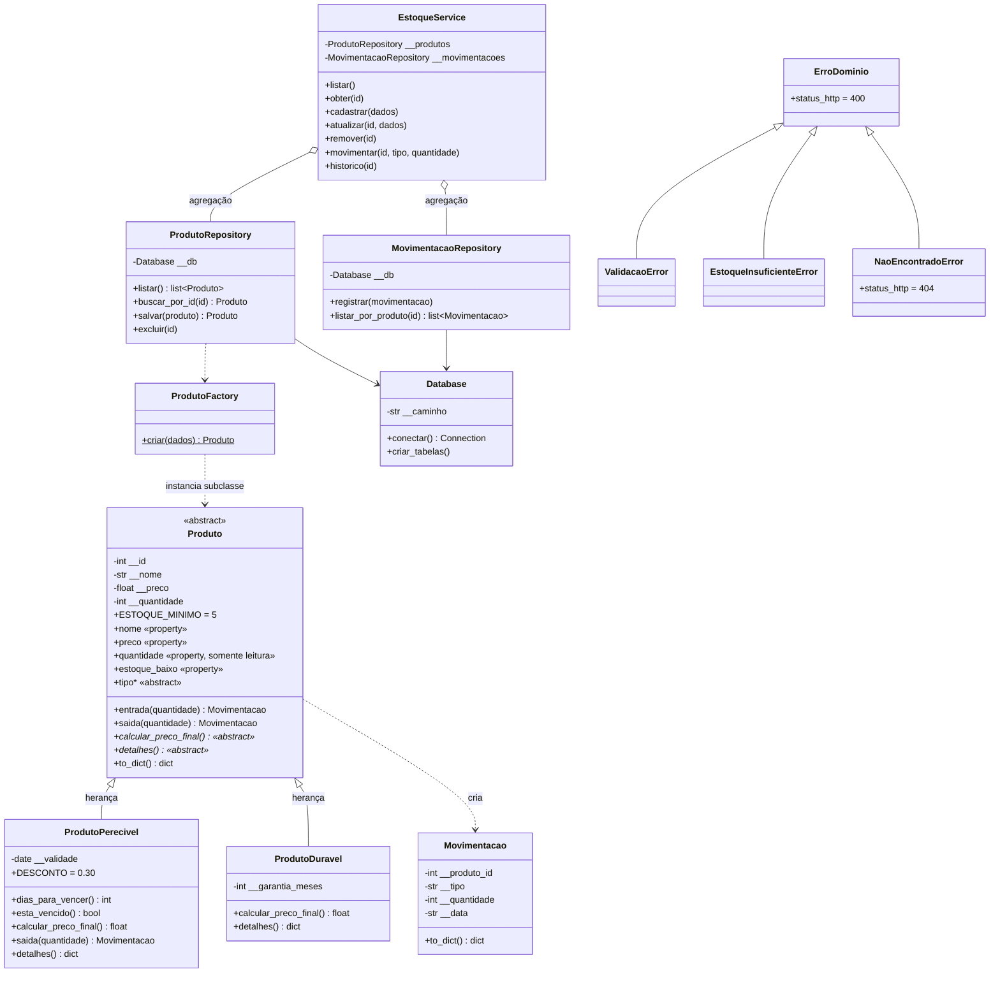

# Diagrama de classes — Back-end (Python)

> O GitHub renderiza este diagrama automaticamente (Mermaid).



## Camadas

```
Navegador (HTML/CSS/JS)  ──fetch/JSON──▶  app.py (rotas Flask)
                                               │
                                        EstoqueService  (regras de negócio)
                                               │
                         ProdutoRepository / MovimentacaoRepository  (SQL)
                                               │
                                          Database ──▶ estoque.db (SQLite)
```
